

The window shows the weather in India right now. The monitor scrolls my latest commits; the shelf holds a book for each language I write.

<a href="https://github.com/omsenjalia"></a>

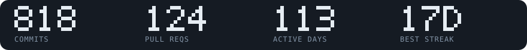

<a href="https://github.com/omsenjalia/configs-ml4w">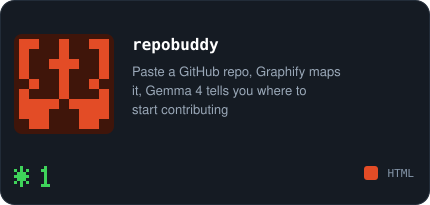</a>

<a href="https://github.com/omsenjalia/ecom-web">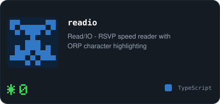</a>

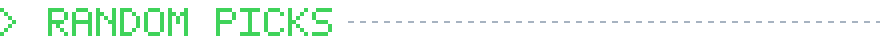

<a href="https://github.com/omsenjalia/forg-globe">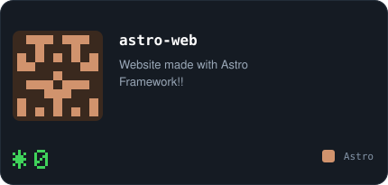</a>
<a href="https://github.com/omsenjalia/claude-export">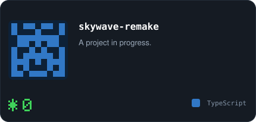</a>
<a href="https://github.com/omsenjalia/docker-debain">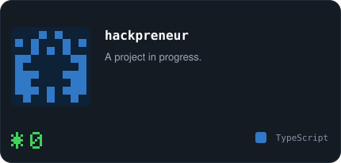</a>
<a href="https://github.com/omsenjalia/claude-latex">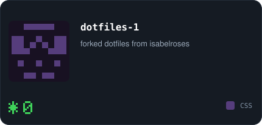</a>



Auto-generated from my GitHub data every 6 hours.

